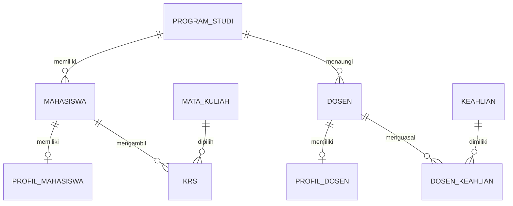

# Database Engineering dengan Laravel

Sumber ketentuan: modul Database Relationship Laravel 12 STTI NIIT I-Tech:
https://drive.google.com/file/d/1ovFuycCV4EefVWoiLyjMBzw5FbjVA1Pn/view

Paket ini melanjutkan VoltAcademic tugas 4: praktik terstruktur bagian 37, tugas mandiri Dosen–Keahlian bagian 39, dan Academic Relationship Manager bagian 41. Materi pengantar hasManyThrough/custom pivot bukan fitur wajib mini project; tidak dibuat entitas tambahan di luar studi kasus.

## Struktur relasi



Profil bersifat opsional, maksimal satu per pemilik. Unique FK menjaga agar tidak ada profil ganda.

| Tabel | Kolom utama | Constraint |
|---|---|---|
|program_studis|id, kode, nama, aktif|kode dan nama unique|
|mahasiswas|id, program_studi_id, nim, nama, email, angkatan, status|prodi FK wajib; nim/email unique|
|profil_mahasiswas|id, mahasiswa_id, tempat_lahir, tanggal_lahir, telepon, alamat|mahasiswa_id unique FK|
|mata_kuliahs|id, kode, nama, sks, semester, deskripsi, aktif|kode unique|
|krs|id, mahasiswa_id, mata_kuliah_id, tahun_akademik, semester, status|unique gabungan mahasiswa+MK+tahun+semester|
|dosens|id, program_studi_id, nidn, nama, email|nidn/email unique; prodi FK wajib|
|profil_dosens|id, dosen_id, telepon, alamat|dosen_id unique FK|
|keahlians|id, kode, nama|kode/nama unique|
|dosen_keahlian|id, dosen_id, keahlian_id, level, tahun_mulai|unique pasangan dosen+keahlian|

Semua tabel memakai timestamps. `semester` master Mata Kuliah adalah angka urutan semester kurikulum; `semester` pada KRS adalah ganjil/genap. Keduanya sengaja berbeda makna.

## Aturan foreign key dan penghapusan

| Child FK | Parent | Saat parent dihapus |
|---|---|---|
|mahasiswas.program_studi_id|program_studis|RESTRICT jika masih ada mahasiswa|
|profil_mahasiswas.mahasiswa_id|mahasiswas|CASCADE profil|
|krs.mahasiswa_id|mahasiswas|CASCADE baris KRS, master MK tetap ada|
|krs.mata_kuliah_id|mata_kuliahs|RESTRICT jika pernah dipakai KRS|
|dosens.program_studi_id|program_studis|RESTRICT jika masih ada dosen|
|profil_dosens.dosen_id|dosens|CASCADE profil|
|dosen_keahlian.dosen_id|dosens|CASCADE hubungan, master keahlian tetap ada|
|dosen_keahlian.keahlian_id|keahlians|RESTRICT jika masih dipakai dosen|

Controller memberi pesan ramah sebelum delete; constraint database tetap menjadi penjaga terakhir. Profil dapat dihapus terpisah tanpa menghapus pemilik. Mata kuliah/program studi nonaktif tetap dapat dibaca pada histori. MK nonaktif tidak bisa ditambahkan ke KRS baru; yang sudah ada boleh dipertahankan atau dilepas.

## Perubahan dari tugas 4

Nama prodi yang dahulu diulang pada mahasiswas.program_studi dipindahkan ke program_studis. Migration menambah FK sementara nullable, membuat master dari nama lama (trim), mengisi setiap FK, mengubah menjadi NOT NULL, lalu menghapus kolom teks lama. ID/NIM/nama/status mahasiswa dipertahankan. Kode LEGACY... hanya kode awal yang bisa diedit. Nama yang sama dipetakan ke satu master.

Tidak ada migrate:fresh. Untuk SQLite migration dapat berjalan secara transaksional; pada MySQL sebagian DDL tidak bisa di-rollback otomatis, sehingga backup sebelum upgrade tetap diperlukan. Rollback migration akan menghilangkan data profil/KRS/dosen/keahlian yang baru dibuat.

## Pemetaan praktik

| Ketentuan | Implementasi |
|---|---|
|One-to-one hasOne/belongsTo|Mahasiswa/ProfilMahasiswa dan Dosen/ProfilDosen|
|One-to-many hasMany/belongsTo|ProgramStudi → Mahasiswa dan Dosen|
|Many-to-many dua arah|Mahasiswa ↔ MataKuliah melalui krs; Dosen ↔ Keahlian melalui dosen_keahlian|
|withPivot / withTimestamps|Kedua sisi hubungan many-to-many pada model|
|Create/update profil lewat relasi|profil()->updateOrCreate di transaksi controller|
|attach|KrsService::attach dari tombol Tambah ke KRS|
|detach|KrsService::change pada DELETE, terbatas periode dan MK|
|updateExistingPivot|KrsService::change pada PATCH status|
|sync|KrsService::save mode ganti; DosenController menyamakan keahlian|
|syncWithoutDetaching|KrsService::save mode tambah|
|Filter relasional whereHas|MahasiswaController@index berdasarkan MK; DosenController@index berdasarkan keahlian|
|Eager loading|with/load prodi, profil dan mata kuliah/keahlian pada daftar/detail|
|withCount|Jumlah mahasiswa/dosen pada master prodi dan laporan|
|Transaction multi-tabel|MahasiswaController::persist dan DosenController::persist menggunakan DB::transaction|
|Constraint duplikat|unique profil dan composite unique KRS/dosen-keahlian|
|Detail seluruh relasi|Detail Mahasiswa (KRS periode terpilih) dan Detail Dosen|

## KRS lintas periode

KRS memiliki histori, sehingga pasangan mahasiswa dan MK boleh muncul pada tahun/semester berbeda. Seluruh sync, detach, updateExistingPivot di-scope melalui `krsPeriode($tahun,$semester)`. Request memvalidasi tahun berurutan (misalnya 2026/2027), semester ganjil/genap dan ID mata kuliah.

KrsService mengunci baris mahasiswa dalam transaksi sebelum menulis. Mode sync mengganti pilihan hanya pada periode yang sedang dipilih, sedangkan mode add memakai syncWithoutDetaching. Status baris lama yang dipertahankan tidak direset menjadi draft. MK baru berstatus draft. Composite unique menjadi perlindungan terakhir terhadap duplikasi.

Contoh penggunaan (jalankan hanya di database latihan; variabel model/ID harus diambil dari database):

```php
$mahasiswa->load(['programStudi', 'profil', 'mataKuliahs']);
$relasi = $mahasiswa->krsPeriode('2026/2027', 'ganjil');
$relasi->updateExistingPivot($mataKuliahId, ['status' => 'disetujui']);
$relasi->detach($mataKuliahId);

$daftar = Mahasiswa::with('programStudi')->whereHas('mataKuliahs',
    fn ($query) => $query->where('kode', 'WEB301'))->get();
$prodis = ProgramStudi::withCount('mahasiswas')->get();
```

Gunakan KrsService dalam aplikasi untuk mempertahankan validasi dan transaction/lock; potongan ini hanya menunjukkan method Eloquent dari modul.

## Dosen dan keahlian

Form Dosen menyimpan dosen, profil, prodi dan daftar keahlian dalam satu transaksi. Level ditetapkan sebagai pemula/menengah/ahli dan tahun_mulai 1950 sampai tahun berjalan (keputusan implementasi, modul hanya menentukan nama atribut). Menghapus centang keahlian akan melepas pivot, bukan menghapus master. Detail memuat semua relasi dengan eager loading.

## Referensi

https://laravel.com/docs/12.x/eloquent-relationships
https://laravel.com/docs/12.x/migrations
https://laravel.com/docs/12.x/database#database-transactions
